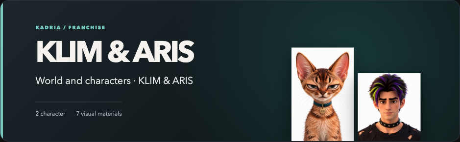
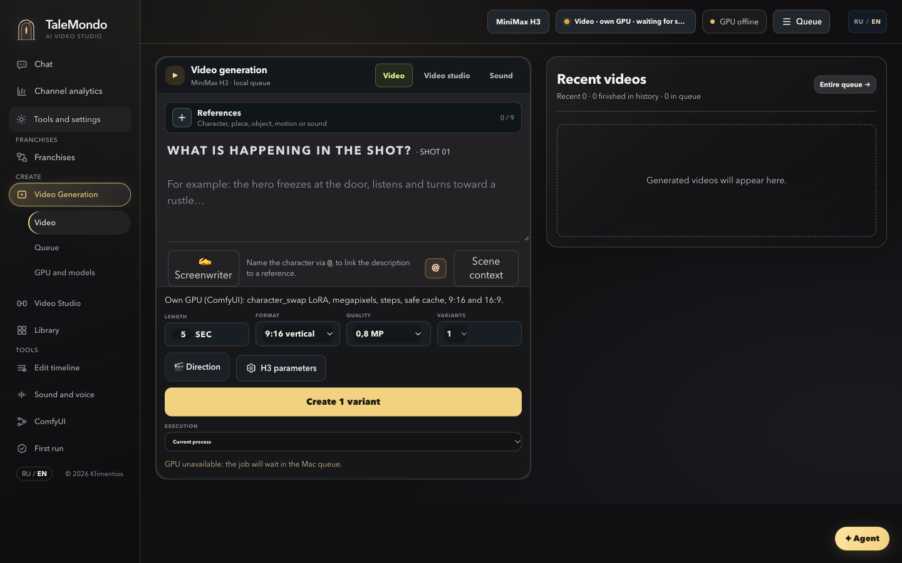
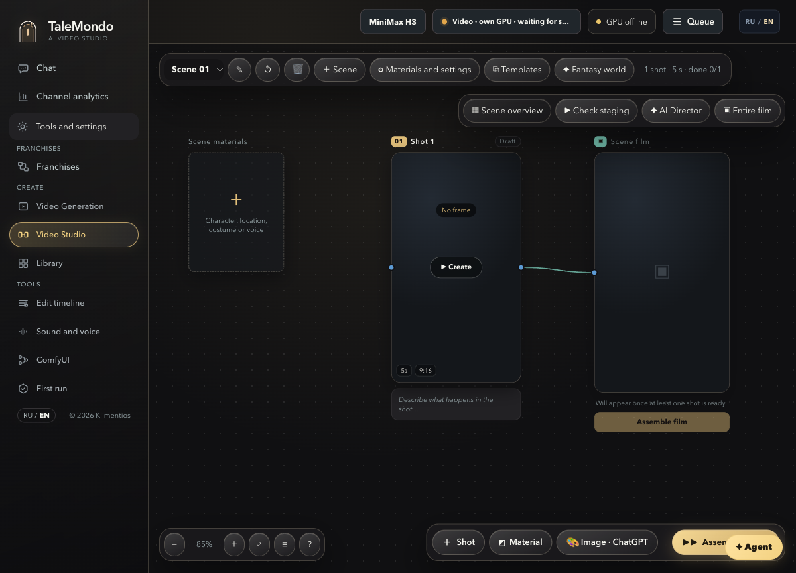
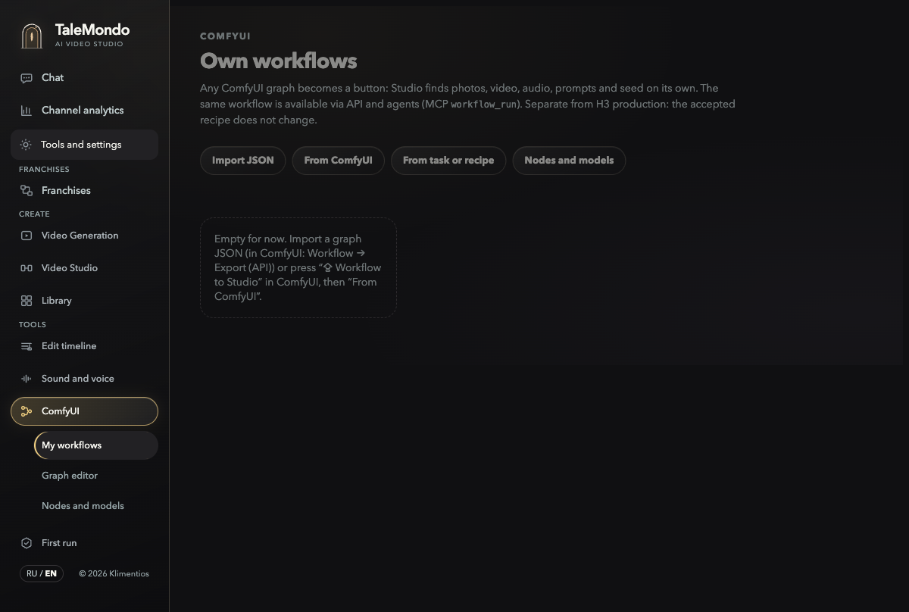

# TaleMondo Studio

**Plan a film. Direct each shot. Keep the references, renders, reviews and edit in one place.**

TaleMondo Studio is my local AI filmmaking workspace built from production work with [MiniMax H3](https://huggingface.co/MiniMaxAI/MiniMax-H3). Its tested generation path uses H3; it also lets users import ComfyUI graphs as custom workflows. Other models depend on their graphs, nodes and hardware and have not been verified here. The Mac interface connects story worlds, scene boards, reference assets, a render queue, take review, editing, ComfyUI graphs and coding agents through MCP. Rendering runs on your own NVIDIA GPU. The interface supports English and Russian. This is an independent, noncommercial application by Klimentios.

**[Watch the Studio tour](docs/media/studio-interface-tour.mp4)** · **[Explore seven video examples](https://github.com/Klimentios/Klimentios/blob/main/writing/talemondo-studio.md#video-gallery)** · **[Read the product walkthrough](https://github.com/Klimentios/Klimentios/blob/main/writing/talemondo-studio.md)** · [MiniMax H3 field notes](https://github.com/Klimentios/Klimentios/blob/main/writing/minimax-h3-field-notes.md)

**Hardware for the documented MiniMax H3 setup:** 96 GB VRAM GPU and 256 GB system RAM. Other ComfyUI graphs may have different requirements; they have not been verified here.

The 25-second tour is an edited, silent view of the interface and selected creative clips; it does not show a live GPU render.

### See the Studio

The first image is a real character project in the working Studio, shown without its internal board notes. The three workspace captures below use an isolated empty data directory; their empty queue and offline GPU reflect that showcase session.

[](https://github.com/Klimentios/Klimentios/blob/main/writing/talemondo-studio.md#inside-the-studio)

| Direct a shot | Build the scene | Bring your ComfyUI graph |
|:---:|:---:|:---:|
| [](https://github.com/Klimentios/Klimentios/blob/main/writing/talemondo-studio.md#inside-the-studio) | [](https://github.com/Klimentios/Klimentios/blob/main/writing/talemondo-studio.md#inside-the-studio) | [](https://github.com/Klimentios/Klimentios/blob/main/writing/talemondo-studio.md#inside-the-studio) |

**Production path:** reference library → story world → scene and shots → GPU queue → take review → edit. [See how the workspaces connect](https://github.com/Klimentios/Klimentios/blob/main/writing/talemondo-studio.md#the-production-path).

## From idea to finished sequence

- **Source library:** Add images, video, and audio as references with roles for face, full character, costume, environment, motion, and camera. Keep prompts and one to four candidate takes with each shot.
- **Scenes and shots:** Plan keyframes, arrange shots into scenes, and record camera, movement, lighting, and colour decisions. Review opening frames before spending GPU time.
- **Story worlds:** Keep character and world guides alongside ideas and shot plans; check shots against the guide to preserve identity and visual continuity.
- **Video adaptation:** Use character-replacement and world-change workflows with configurable settings and reusable recipes stored in Studio data.
- **Render and review:** Queue generation on your GPU, inspect the resulting MP4, compare takes, and approve or reject them. Pre-render checks catch some prompt and continuity errors; final visual and audio quality still need human review.
- **Editing:** Build an edit list with transitions and sound, then export for Premiere Pro, DaVinci Resolve, or Final Cut Pro.
- **Custom workflows:** Import a ComfyUI graph as a Studio form, REST endpoint, and agent tool. Compatibility depends on the graph, model, and installed nodes.
- **Agents:** The `h3-studio` MCP server in `scripts/h3_studio_mcp.py` exposes scene-building, render-queue, and review tools to Claude Code and Codex.

### ComfyUI ↔ Studio

With a connected ComfyUI server and the Studio bridge extension, send a graph from ComfyUI with **Workflow to Studio**. Studio turns selected graph inputs into a form and exposes the saved workflow through its local API and MCP tools. Use **Open in ComfyUI** to edit the graph in the real ComfyUI editor, then send it back to the same Studio workflow. Revisions remain available for review and restore. You can also fork an H3 job graph or accepted recipe into a separate custom workflow without changing the original. [See the illustrated walkthrough and implementation links](https://github.com/Klimentios/Klimentios/blob/main/writing/talemondo-studio.md#the-comfyui-to-studio-loop).

## Interface language

Use the RU/EN switch at the bottom of the side menu. On first launch, Studio selects a language from the browser. The English translation layer lives in `preview/h3-director/dom-translate.mjs` and `preview/h3-director/i18n/en.json`.

## Install on Mac

Run `Install Studio.command` in the repository root. If macOS blocks it, use the Finder context menu and choose **Open**. The installer sets up Python, ffmpeg, and the Studio service, then opens the five-step first-run wizard at `http://127.0.0.1:18187/setup.html`. Studio data lives in `$H3_MAC_DATA_DIR`, defaulting to `~/Library/Application Support/H3 Studio`, outside the repository. See the [installation guide](docs/guides/STUDIO_INSTALL.md).

## Connect a GPU server

For the bundled MiniMax H3 server setup, plan for an NVIDIA GPU with at least 96 GB VRAM, 256 GB system RAM, 500 GB storage, and Ubuntu with root SSH access. The custom-workflow importer accepts ComfyUI graphs, but other model paths have not been verified here; requirements depend on the graph and model. Vast.ai and RunPod are example hosts; availability and prices vary.

The first-run wizard can provision a Vast.ai machine through **GPU & Models**. To configure an existing server from the Mac:

```bash
bash scripts/h3_new_server.sh --host root@HOST --port PORT
```

The setup installs a pinned ComfyUI build, public MiniMax H3 weights from Hugging Face with SHA-256 verification, Studio nodes, and the GPU API. Verify the deployment without starting a render:

```bash
bash scripts/verify_h3_server.sh --host root@HOST --port PORT
```

See the [server setup guide](docs/reference/H3_SERVER_FROM_ZERO.md). Model weights are downloaded separately and are not included here. The default local profile favours BF16 quality and 24 steps; Turbo LoRAs, other profiles, and 4–50 steps are optional. Performance and quality depend on the hardware, model, references, and workflow settings.

The code also contains a MiniMax API route for 768P jobs. Its availability depends on MiniMax's current service; the local GPU path is the primary documented setup. Video character replacement runs on your own GPU.

## Examples and upstream credits

The [product walkthrough](https://github.com/Klimentios/Klimentios/blob/main/writing/talemondo-studio.md) explains the workspace and links seven video examples. These creative examples are not controlled comparisons or proof that each clip used the same workflow.

- [MiniMax AI](https://huggingface.co/MiniMaxAI/MiniMax-H3) developed the H3 model.
- [Comfy-Org](https://github.com/Comfy-Org/ComfyUI/blob/master/comfy_extras/nodes_minimax_h3.py) provides the native H3 nodes in ComfyUI.
- [Kijai](https://github.com/kijai/ComfyUI-KJNodes) maintains tools used in optional Studio paths, including colour matching.

TaleMondo Studio is not an official release of MiniMax AI, Comfy-Org, or Kijai. Their models, nodes, and tools retain their own licences and attribution requirements; see [NOTICE](NOTICE).

## Checks

```bash
python -m pytest tests
cd preview/h3-director && node --test *.test.mjs
```

These commands run existing tests. They do not certify the visual or audio quality of a generated video.

## Author and licence

Copyright 2026 **Klimentios**. Contact details are available through the GitHub profile.

The Studio code is licensed under [PolyForm Noncommercial 1.0.0](LICENSE). You may use, study, modify, extend, and share it for noncommercial purposes under that licence. Keep the `LICENSE` file and its `Required Notice: Copyright (c) 2026 Klimentios` line in redistributed copies, including modified versions. Commercial use requires separate written permission from the author. Third-party components retain their own licences; see [NOTICE](NOTICE).

The TaleMondo name is the author's product name, not a licence grant for branding. Distribute modified versions under a different name and do not present them as an official TaleMondo release. Check the terms of every model and LoRA before use; their weights and licences are separate from the Studio code.
