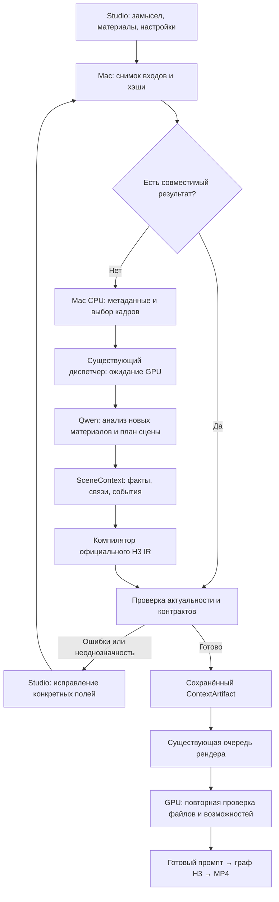

# STUDIO Context-IR — архитектура локальной подготовки контекста H3

Дата исходного проекта: 2026-10-09. Обновлено: 2026-10-15.
Статус: это целевая архитектура и границы дизайна; часть уже реализована как `context-ir-2`.
Точное текущее состояние модулей, интерфейсов и проверок — в [документе реализации](H3_CONTEXT_IR_IMPLEMENTATION.md).
Mac `GET /api/context-ir/capabilities` сейчас отвечает `200`, версия `context-ir-2`, workflows
`h3`, `video_edit`, `motion`; `gpu_ready=false`, `state=offline`. Живой Qwen и видеорезультат
этой проверкой не подтверждены.
Уточнение пользователя: основной сценарий — работа с референсами, перенос движения и
изменения исходных материалов. Генерация без референсов исключена из этого пути.
Основание: исходники на `d98614c`, текущие контракты Studio и запрос пользователя.

Цель: преобразовать замысел и референсы в согласованный, проверяемый контекст H3,
уменьшая потери инструкций и число неудачных дублей при ограниченной стоимости подготовки.
Это собственная реализация функций Context-IR; паритет с закрытой системой MiniMax требует сравнения.

## 1. Принятое архитектурное решение

Модульный компонент внутри существующих Mac Studio и GPU API. Используем имеющиеся
Python/Pydantic, SQLite, FFmpeg и локальный Qwen. Новые сервисы, брокер сообщений,
векторная база, отдельный GPU и обучение модели для первой версии не требуются.

Результат подготовки — неизменяемый `ContextArtifact`: структурированный контекст,
проверенный промпт из шести секций, привязки источников, снимок настроек и отчёт проверки.
Рендер получает этот артефакт через адаптер существующего `POST /api/jobs`.
Единица подготовки — один клип H3; длинный фильм остаётся задачей существующего Story.



## 2. Что уже есть и чего не хватает

| Существующий компонент | Использование в новой архитектуре |
|---|---|
| `app/h3_ir.py` | `build_skeleton`, метки источников, шесть секций, `render_ir`, `validate_ir`; расширять через адаптер |
| `app/scenarist.py` | Локальный Qwen, проверка ответа и один корректирующий запрос; выделить переиспользуемый вызов модели |
| `local_studio/scenarist.py` | Текущий мост к GPU; сейчас прикрепляет превью только изображений |
| `app/director.py` | Подготовка визуальных входов, оценка бюджета контекста, жизненный цикл Qwen |
| `app/reference_manifest.py` | Контракт файлов и их привязок; номера H3 выводятся из окончательного порядка входов |
| `app/main.py` | `precompiled_prompt` пропускает повторный вызов Director; остаются преобразования промпта и сборка графа |
| `local_studio/main.py` | Единый диспетчер H3, ключевых кадров, звука, апскейла и правки видео |
| `app/qwen_lifecycle.py` | Общие блокировки подготовки и отправки рендера, освобождение моделей |
| `app/job_registry.py` | Образец сохранения квитанций и восстановления неоднозначной отправки |
| `app/director_schema.json` | Единственный источник полей и значений режиссуры |

Текущий `/api/scenarist` получает роли видео/аудио, но Mac-мост не передаёт ему их
содержимое для полноценного анализа. В Director существует отдельная выборка видеокадров;
это не даёт оснований объявлять текущего сценариста анализатором движения или звука.
Новый слой должен явно фиксировать, какие материалы действительно прочитаны.

## 3. Границы компонентов и владельцы данных

| Компонент | Ответственность | Место |
|---|---|---|
| Input Snapshot | Зафиксировать бриф, ссылки на assets, их хэши, роли, владельцев, настройки и ревизию сцены | Mac |
| Media Preparation | Проверить тип/длительность, подготовить ограниченные превью и видеокадры с таймкодами | Mac CPU |
| Evidence Analyzer | Описать наблюдаемое в новых материалах, указать источники и неопределённость | Qwen на GPU |
| Context Planner | Связать героев, материалы и события; сформировать план в пределах длительности | Qwen на GPU |
| IR Compiler | Собрать метки, retention, шоты и шесть секций по проверенному контексту | Чистый Python |
| Validator | Проверить ссылки, настройки, тайминг, обязательные инструкции и ограничения | Mac и GPU |
| Artifact Store | Сохранить версии контекста, результаты подготовки и кэш | Mac SQLite и файлы |
| Render Adapter | Проверить артефакт и преобразовать его в существующее задание | Mac worker / GPU API |

Mac владеет оригиналами, пользовательскими исправлениями и историей артефактов. GPU
владеет состоянием вычисления и квитанцией; его временные файлы не являются единственной копией результата.
GPU не определяет роли файлов по их порядку загрузки и не изменяет пользовательские assets.
Записи артефактов и кэша вводятся будущей аддитивной миграцией. При подготовке этого документа
рабочая база Studio и файлы медиатеки не изменяются.

Предлагаемая раскладка кода при реализации:

- `app/context_ir/`: `schema.py`, `analyzer.py`, `planner.py`, `compiler.py`, `validation.py`, `router.py`.
- `local_studio/context_ir/`: `store.py`, `media.py`, `queue.py`, `router.py`.
- `preview/h3-director/context-ir.mjs`: панель проверки в существующем рабочем пространстве.

Схема и чистые валидаторы импортируются обеими сторонами из одного источника. Перечни
камер, света и стилей продолжают читаться из `director_schema.json`. Старые маршруты
получают адаптеры постепенно; общий рефакторинг Director не является условием старта.

## 4. Контракт SceneContext v1

Внутреннее представление — типизированный JSON, а в H3 отправляется официальный текст.
JSON не приклеивается к промпту как дополнительная инструкция.

| Поле | Содержание и инвариант |
|---|---|
| `schema_version`, `revision`, `input_hash` | Версия контракта, ревизия сцены и отпечаток входов |
| `intent` | Исходный бриф, язык, обязательные требования, разрешённые дополнения |
| `assets` | Стабильный `asset_id`, SHA-256, тип, роль, владелец, область использования/таймкоды |
| `evidence` | Наблюдение, источник asset/frame/time, версия анализатора, статус `observed/inferred/unknown` |
| `subjects` | Стабильные ID героев/объектов, источники внешности, одежды, движения и голоса |
| `shots` | Границы в кадрах, начальное/конечное состояние, участники, события и камера |
| `dialogue` | Точная реплика, язык, ID говорящего, интервал; текст не переводится автоматически |
| `audio` | Атмосфера, эффекты, музыка, голосовые источники и явная тишина |
| `constraints` | Что сохранять, что менять, что обязательно показать; ссылки на исходные требования |
| `settings_snapshot` | Проверенные настройки из существующего контракта Studio |
| `unresolved` | Конфликты, недостающие сведения и поля для ручного исправления |

Каждое значимое решение хранит происхождение: `user`, `asset_observation`,
`model_inference` или `default`, и ссылки на подтверждающие входы. Модель не выставляет
выдуманный процент уверенности. Пользовательские исправления имеют приоритет над предположениями.

Пример фрагмента события, не полного API-запроса:

```json
{
  "subject_id": "hero_a",
  "time_range_frames": [24, 72],
  "action": "поднимает меч правой рукой",
  "initial_state": "меч опущен вдоль правого бедра",
  "final_state": "меч перед грудью, остриё направлено вверх",
  "source": "user",
  "requirement_id": "brief_action_1"
}
```

Внутренние интервалы полуоткрытые `[start, end)`. Число кадров и допустимая длина
получаются из существующего расчёта H3; компилятор переводит их в таймкоды официального
формата. Так округление секунд не накапливается между шотами.

Номера `<Subject N>`, `<Picture N>`, `<Video N>`, `<Audio N>` назначает компилятор.
Учитываются дорожки видео и правила нумерации существующего манифеста. Модель оперирует
стабильными ID; перестановка загрузок не должна менять владельца костюма или голоса.
Неоднозначная привязка нескольких героев блокирует готовность артефакта.

## 5. Анализ и компиляция

1. Mac фиксирует снимок входов до первого сетевого запроса. Последующая правка создаёт
   новую ревизию; ответ старой ревизии остаётся в истории и не перезаписывает текущую сцену.
2. Проверяются доступность файлов, хэши, допустимые размеры, длительности и роли.
   Производные изображения для анализа отделены от оригиналов, поступающих в H3.
3. Для каждого нового asset создаётся EvidenceRecord. Изображение описывается по видимым
   признакам; видео — по кадрам с таймкодами. Политика выборки ограничена бюджетом контекста
   и версионируется; редкие кадры не доказывают точную траекторию быстрого движения.
4. Planner использует бриф, настройки и evidence. Для первого MVP с фото анализ и план
   могут выполняться одним структурированным запросом. Выделенный повторно используемый
   анализ вводится следующим этапом. Для новых сложных видео допустим отдельный проход анализа.
5. Компилятор кодом строит определения субъектов, retention и заголовки шотов. Qwen
   заполняет творческие поля плана, из которых собираются описание, звук и музыка.
6. Проверка обычным кодом выполняется всегда. При исправимых ошибках допускается один
   дополнительный запрос Qwen с конкретными замечаниями. Ошибка после него остаётся видимой.
7. Сохраняется ContextArtifact; подготовка сама по себе не создаёт видеорендер.
8. Render Adapter подаёт готовый текст через `precompiled_prompt`, исключая второй
   творческий пересказ Director. Все существующие проверки графа продолжают действовать.

Компилятор сохраняет шесть секций: `subject_definitions`, `summary`, `retention_analysis`,
`detailed_description`, `overall_soundscape`, `non_diegetic_music`. Объём текста следует
официальному формату; сокращаются повторы, а не обязательные указания и реплики.

Проверка делится по силе доказательства. Неверные ссылки, неизвестные настройки,
отсутствующие файлы и выход тайминга за границы — блокирующие ошибки. Неестественная
физика или слишком сложная хореография — замечания модели/эвристики: валидатор не может
гарантировать физическую корректность будущего видео. Конфликт двух явных указаний
показывается пользователю; модель не выбирает молча, какое указание отбросить.

Анализ речи и акустики — отдельная capability следующей версии. Пока её нет, аудио
может передаваться H3 как исходный референс, а его содержимое обозначается `unknown`.
Если запрос требует понять слова или звуковое событие из файла, без анализа такой запрос
не объявляется подготовленным. Чтение метаданных аудио не называется прослушиванием.

## 6. ContextArtifact и соответствие реальному графу

Артефакт содержит `artifact_id`, SceneContext, официальный промпт, `binding_map`,
хэш настроек, хэши файлов, версию компилятора, ревизию модели/шаблона и отчёт проверки.
Неразрешённая ревизия модели должна явно фиксироваться как неизвестная; кэш нельзя
считать воспроизводимым между такими развёртываниями без нового отпечатка deployment.

Для каждой режиссёрской настройки сохраняется способ исполнения:
`native_input`, `graph_node`, `prompt_only` или `unsupported`. Доказательство — путь
поля/узла либо фрагмент текста. Context-IR не превращает текстовое управление камерой
в нативное и не обещает покадровую фиксацию движения.

Перед отправкой сверяются текущие capabilities, файлы, порядок и владельцы референсов,
хэш схемы режиссуры и версия адаптера. Хэш обеспечивает проверку целостности, но не
доверие к произвольному JSON из браузера: GPU повторно валидирует контракт самостоятельно.

Существующая ветка `precompiled_prompt` ещё преобразует текст. Поэтому необходимо
сохранять отдельно `compiled_prompt_hash` и `effective_prompt_hash` фактического входа
H3, а также версию адаптера и отпечаток графа. Приёмочный тест проверяет итоговый
вход узла, отсутствие второго Qwen-вызова и сохранение смысла обязательных инструкций.

## 7. Кэш и стоимость подготовки

| Слой | Ключ | Что инвалидирует |
|---|---|---|
| Производные медиа | SHA-256 оригинала + версия обработки + параметры/таймкоды | Новый файл или другая выборка |
| Evidence | Производные медиа + ревизия анализатора/модели + шаблон + параметры inference | Другая модель или способ анализа |
| SceneContext | Нормализованный бриф + evidence hashes + роли/владельцы + ограничения + настройки + версия Planner | Изменение контекста сцены |
| Compiled IR | SceneContext hash + порядок входов + версия компилятора/схемы | Перепривязка или изменение контракта |

Evidence описывает наблюдаемое в файле независимо от назначенной пользователем роли;
если запрос анализа зависит от роли, она обязательно входит в ключ. Кэш ограничен
текущей медиатекой, а не общий между пользователями. Сохраняются только успешно
проверенные, полностью записанные записи; ошибки и частичные ответы не становятся hit.

Изменение seed не требует анализа или нового текста, но создаёт новый снимок задания.
Изменение реплики инвалидирует план/промпт, сохраняя визуальные evidence. Переназначение
костюма другому герою инвалидирует связи и промпт, сохраняя описание самого изображения.
Новый файл инвалидирует его производные и все зависимые артефакты; старые версии
остаются пригодны только для воспроизведения своих прежних заданий.

При полном cache hit Qwen не вызывается. При cache miss стоимость включает подготовку
медиа, ожидание GPU, пробуждение, один основной запрос и при необходимости один ремонт.
Для нового видео отдельный анализ увеличивает число запросов; показываем это в метриках.
Пользователь может явно пересобрать план с новым `variation_id`; обычный повтор запроса
возвращает сохранённый результат. Температура модели не гарантирует идентичного пересоздания.

Кэш имеет настраиваемый лимит и LRU-очистку только воспроизводимых производных.
Assets, MP4 и артефакты, закреплённые за заданиями, не удаляются очисткой кэша.

## 8. GPU, очередь и восстановление

Режим первой версии — одна вычисляющая модель на GPU. CPU-подготовка возможна во время
рендера, Qwen-анализ — только после освобождения GPU. Подготовка Context-IR добавляется
как тип работы в существующий диспетчер с общими pause/FIFO, без своей конкурирующей очереди.
Явные запросы идут в очередь; спекулятивный фоновый анализ всей библиотеки выключен.

Проверки свободного GPU недостаточно вне блокировки: между проверкой и wake может
прийти рендер. Проверка, освобождение H3, wake и запрос выполняются под общим
протоколом `planning_lock`/lifecycle; все отправители графов используют совместимый
`render_submission`. Новые несогласованные mutex не добавляются. Sleep выполняется
в `finally`; при неподтверждённом освобождении памяти следующий GPU-этап блокируется.
Пауза останавливает новые отправки, текущий рендер не прерывается.

Предлагаемые состояния подготовки:

`queued_local → preparing_media → waiting_gpu → analyzing → compiling → validating → ready`.

Ответвления: `needs_input`, `failed`, `cancelled`, `needs_reconciliation`.
Cache hit переходит из подготовки непосредственно к проверке. В интерфейсе показываются
этап и прошедшее время; проценты допускаются только для измеряемых операций.

Клиент сохраняет `client_request_id` и input hash до POST. GPU атомарно сохраняет
квитанцию до вычисления. Повтор того же ID и hash возвращает ту же операцию, другого
hash — 409. При потерянном ответе Mac запрашивает квитанцию по тому же ID. Смена GPU
не означает разрешение создать новый рендер. Восстановление вычисления контекста
допустимо лишь после сверки состояния; попытки ограничены и сохраняются в истории.

Отмена подготовки не отменяет существующие рендеры. Разрыв HTTP не означает, что
поток inference остановился: блокировка сохраняется до выхода вычисления и sleep.
После перезапуска зависшие операции переводятся в сверку; частичный артефакт не выдаётся.
При недоступном GPU готовый локальный артефакт можно просмотреть и проверить кодом;
новый анализ ожидает сервер. Тихого переключения на платный API или иной рецепт нет.

## 9. API и интерфейс: проект и реализация

Исходная таблица ниже заменена сверкой с реализованным Context-IR v2. Mac capability
`GET /api/context-ir/capabilities` сейчас отвечает, но сообщает `gpu_ready=false`.

| Маршрут Mac | Назначение |
|---|---|
| `GET /api/context-ir/capabilities` | Версия контракта, доступные workflows, состояние совместимости GPU |
| `POST /api/context-ir/jobs` / `GET /api/context-ir/jobs` | Создать подготовку с idempotency receipt / список сохранённых операций |
| `GET /api/context-ir/jobs/{id}` | Состояние, результат, ошибки и cache hit |
| `POST /api/context-ir/jobs/{id}/cancel` | Запросить отмену подготовки |
| `GET /api/context-ir/jobs/{id}/execution` | Перепроверить сохранённый execution manifest для edit/motion |
| `POST /api/context-ir/jobs/{id}/render` | Подать готовый H3 Context-IR в обычную очередь с client request ID |

GPU реализует `POST /api/context-ir/jobs` и `GET /api/context-ir/jobs/{id}` для подготовки;
рендеринг и edit/motion остаются за соответствующими обычными очередями/адаптерами.
Capability family в `/api/capabilities` называется `context_ir_v1`, а фактическая схема
проверяется отдельной версией (`context-ir-2`) и fingerprint. Артефакт не вводит второй
GPU-диспетчер; несовместимость должна блокировать отправку до GPU-очереди.

В Studio — компактный блок «Проверка сцены»: герои и их источники, действия по времени,
звук, замечания. Полный IR раскрывается отдельно. Исправление владельца/действия создаёт
новую ревизию. Готовый артефакт прикрепляется к обычному нажатию «Создать» без отдельного
подтверждения каждого успешного анализа. При блокирующем конфликте показывается конкретное поле.
Текст и фотографии из референсов считаются данными: инструкции внутри них не могут
запускать команды, менять настройки или переопределять пользовательский замысел.
В API используются asset IDs из медиатеки, а не произвольные пути или внешние URL.

## 10. Внедрение и условия приёмки

| Этап | Результат | Условие перехода |
|---|---|---|
| 1. Основа и режим сравнения | Schema, компилятор, валидатор, immutable artifacts; кандидат создаётся отдельно от текущего промпта | Проверены привязки, тайминг, сохранность инструкций, сравнение итоговых текстов |
| 2. Рабочий MVP для фото | Qwen → SceneContext → IR, очередь подготовки, просмотр результата, адаптер precompiled | Готовый артефакт доходит до реального входа графа; нет второго планирования и дублирующих операций |
| 3. Повторное использование | Evidence/cache, частичная инвалидация, анализ видео с таймкодами | Смена seed/реплики/владельца даёт ожидаемые hit/miss; ограничения анализа видимы |
| 4. Проверка качества | Контролируемое A/B на GPU, оценка MP4 | Качество не ухудшилось, измерена цена подготовки и польза на сложных сценах |
| 5. Расширение | Аудиоанализ, контекст между клипами, более сильный Planner при необходимости | Отдельные capability и доказанная польза по замерам |

Текущий путь остаётся default до A/B. Включение кандидата — явный выбор рецепта.
Для «только фото» соблюдается защита эталонного графа (`tests/golden/`): изменение пути требует A/B и согласия
пользователя. Откат выключает выбор новой подготовки; ранее сохранённые артефакты
не пересобираются автоматически. Эта архитектура относится к H3 в «Создать»; она
не заменяет LTX-пайплайны правки видео и Motion Control.

Минимальные значимые проверки при реализации:

- Два героя с лицом/костюмом/голосом: правильные связи, отказ при неоднозначности.
- Изменение seed, реплики, владельца и байтов файла: правильная инвалидация.
- Повтор POST, потеря ответа, перезапуск и устаревшая ревизия: отсутствие дублирования и перезаписи.
- Qwen во время H3, отмена во время inference и ошибка sleep: отсутствие конфликтующих вычислений.
- Готовый IR: сверка реального входа графа, обязательных реплик и настроек, отсутствие второго Qwen.

Использовать существующие тесты и несколько проверок этих рисков, без нового тестового
фреймворка. `scripts/check.sh` обязателен перед коммитом. Для GPU — сначала
`scripts/verify_h3_server.sh`, затем согласованный ограниченный A/B.

Для A/B берутся 3–5 разных сцен: один герой, два героя с предметом, движение по видео,
диалог, камера с несколькими действиями. Внутри пары одинаковые seed, референсы,
длительность, шаги, разрешение, LoRA и sampling/cache settings; изменяется подготовка
промпта. По возможности оценивать без подписи варианта. Малый набор — проверка
направления, не доказательство универсального превосходства.

## 11. Метрики и ограничения обещаний

Отдельно записываются: media preparation, queue wait, wake/sleep, анализ, планирование,
компиляция, upload, фактический render time, cache hit/miss и число исправляющих запросов.
Модель и шаблон фиксируются вместе с токенами и кодами ошибок, без секретов и полного
содержимого медиа в обычных логах. Пользовательские артефакты доступны через Studio.

Основной результат: время и GPU-затраты до принятого пользователем ролика, доля
принятых дублей и причины брака. До накопления данных показываются реальные отдельные
замеры; p50/p95 имеют смысл только при достаточной выборке с указанным размером.

Context-IR напрямую не сокращает шаги диффузии. Новый анализ добавляет задержку;
кэш и исключение повторного Director могут уменьшить подготовку. Более точный контекст
может сократить перегенерации, но это гипотеза до A/B. Длина промпта также влияет на
обработку H3, поэтому измеряется отдельно. Сохранение личности, физика и точность
переноса движения подтверждаются видео, а не зелёным валидатором.

## Источники и границы проверки

- [MiniMax H3: Context-IR](https://huggingface.co/MiniMaxAI/MiniMax-H3#h3-context-ir):
  закрытая многоэтапная обработка контекста; официальный текст допускает собственный preprocessing.
- [Карта Studio](STUDIO_STRUCTURE.md), [контракт настроек](H3_PROMPT_WRITER_SETTINGS_CONTRACT.md),
  [руководство промптов](../guides/H3_PROMPT_GUIDE.md), [эталонные графы](../../tests/golden/).
- Проверены исходники `h3_ir`, `scenarist`, Mac-моста, ветки `precompiled_prompt`,
  диспетчера и lifecycle. Доступность текущего GPU, качество новой модели и скорость
  предлагаемого Context-IR этим документом не подтверждаются.
